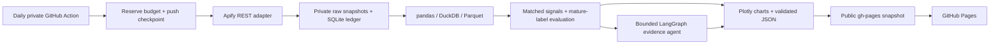

# SEA TikTok Opportunity Radar

A reproducible Southeast Asia TikTok Shop research system: **daily sampled collection → historical analysis → chart generation → bounded evidence agent → public dashboard**.

[Dashboard](https://xuanbomalay.github.io/sea-tiktok-opportunity-radar/) · [Clearly labeled synthetic demo](https://xuanbomalay.github.io/sea-tiktok-opportunity-radar/demo/) · [中文说明](docs/中文学习说明.md) · [Operations](docs/OPERATIONS.md)

> **Research status:** live data access requires configured credentials and verified provider responses. The separate demo uses invented test fixtures. It is not market evidence. Forecast validation starts only after 84 observation dates and 500 mature labels. No 4x efficiency, brand-incubation, sales or profitability claim is made.

## What this project demonstrates

- Public product-counter research across **Malaysia, Thailand and Vietnam**, in home storage, kitchen tools and pet accessories.
- Conservative parsing of exact versus rounded counters, local currencies, collection failures and vendor schema changes.
- pandas / DuckDB / Parquet analysis, a private durable budget ledger, and repeatable raw-data provenance.
- Matched-product demand signals, sample seller diversity, interactive Plotly charts and downloadable PNGs.
- Purged chronological evaluation of a recent-mean baseline, Ridge and gradient boosting; failed experiments are retained.
- A LangGraph/Gemini tool-using agent that can select only validated evidence IDs, with a labeled rule-based fallback.
- Daily GitHub Actions, private raw history and atomic public snapshot deployments.

## Architecture



## Run locally

Use Python 3.12 (3.11+ supported). A GPU and a TikTok developer account are not required.

```bash
python -m venv .venv
# Windows: .venv\Scripts\activate
# macOS/Linux: source .venv/bin/activate
python -m pip install -r requirements.lock
python -m pip install --no-deps -e .
python -m radar bootstrap --output dist --no-agent
python -m http.server 8765 --directory dist --bind 127.0.0.1
```

Open `http://127.0.0.1:8765`. Kaleido requires an installed Chrome/Chromium browser for PNG exports. `--no-images` is an explicit partial-verification mode if a browser is unavailable.

### Real collection

Set `APIFY_TOKEN` in your environment, then:

```bash
python -m radar run --state-dir private --output dist
python -m radar evaluate --state-dir private
```

The command returns exit code 2 for unsuccessful/missing-credential collection after producing an honest status page. An optional free-only `GEMINI_API_KEY` and `GEMINI_FREE_TIER_ONLY=true` enable the agent. Keys are not automatically read from `.env` and are never included in browser assets.

### Offline demonstration and reproducibility

```bash
python scripts/make_demo.py
python -m radar replay artifacts/synthetic.json --synthetic --output dist/demo --no-agent
python -m radar evaluate --synthetic --state-dir artifacts/synthetic-state
pytest
```

Live replay accepts the same provenance envelope with `synthetic: false`; see the [Data Card](docs/DATA_CARD.md). The program refuses to mix synthetic and live state.

## How to interpret the charts

- **Demand**: seven-day displayed-counter changes; growth compares the same listings at t, t−7 and t−14, with the same provider.
- **Competition proxy**: distinct observed sellers / sampled listings, plus seller HHI based on listing shares. This is **not** a whole-market competition estimate.
- **Coverage heatmap**: observed product counts, not category size or revenue.
- **Price**: local currencies; the dashboard requires one selected country for price trends.
- **Forecast**: next seven-day public-counter increment, not actual orders. Missing/rounded values are not treated as zero.

## Costs and operational limits

Initial caps: 27 reserved result slots/day, 1,000/month and **$4/month acquisition reservations**, including tests, failures and ambiguous starts. Each external run also has a server-side charge cap. Free platform allowances and provider availability can change; check the [source register](docs/DATA_CARD.md) before activation. Other activity in the same vendor account also consumes its allowance.

Private scheduled runs may consume GitHub account Actions minutes. Use standard hosted runners, no paid overage, and review the account-wide quota. Schedules may be delayed, and public schedules may be disabled after inactivity; the health panel exposes observation freshness.

## Evidence and delivery

- [Data Card and verified documentation sources](docs/DATA_CARD.md)
- [Model Card and leakage controls](docs/MODEL_CARD.md)
- [Account setup, secrets and recovery](docs/OPERATIONS.md)
- [Acceptance checklist and unverified milestones](docs/ACCEPTANCE.md)
- [Resume wording and efficiency measurement](docs/RESUME_AND_BENCHMARK.md)
- [Colab research notebook](notebooks/Research_Walkthrough.ipynb)

Code is MIT licensed. Third-party data are not licensed by this repository. Synthetic fixtures are generated by this project's own code; private vendor data are not redistributed as an open dataset.
